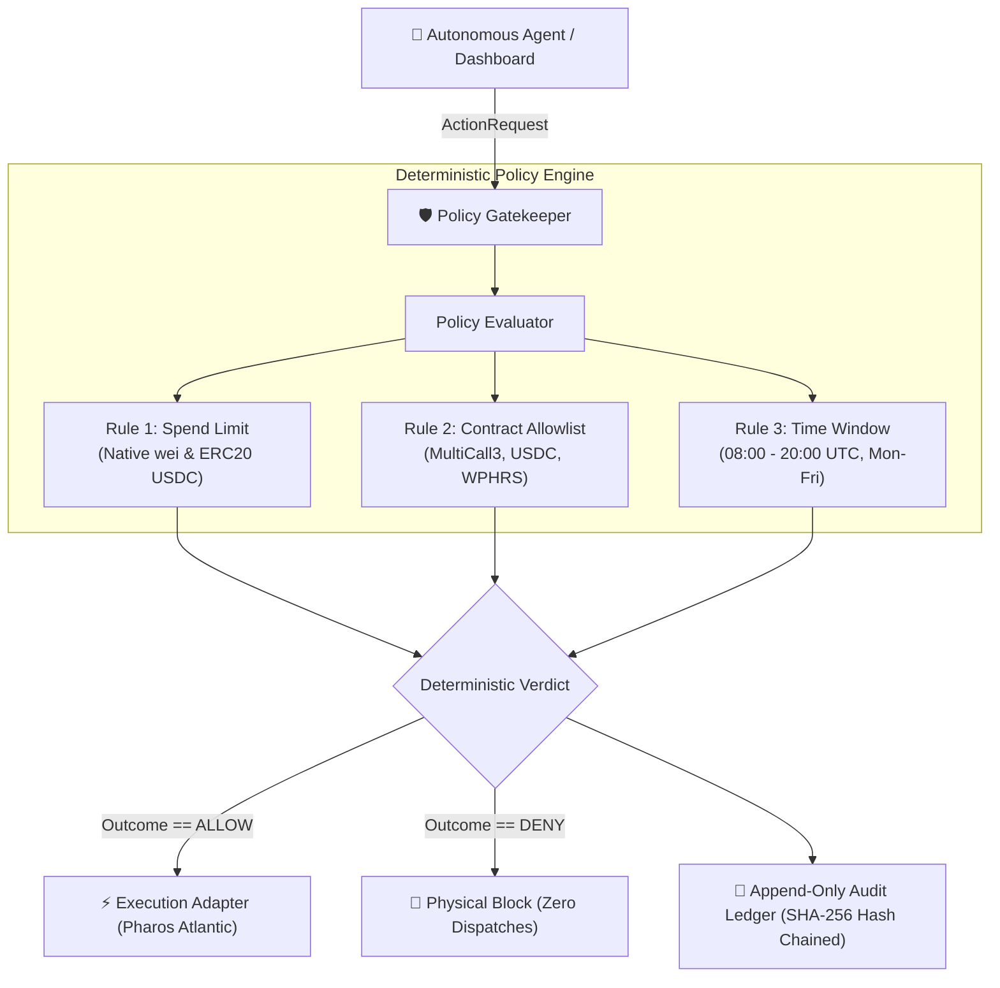

# Pharos Policy Gatekeeper

[](https://atlantic.dplabs-internal.com)
[](#)
[](#automated-testing)
[](LICENSE)
[](#pharos-rpc-compatibility)

A deterministic, fail-closed policy enforcement engine and tamper-evident audit ledger for autonomous agents on the Pharos blockchain (`Chain ID: 688689`). Sits directly between agent decision logic and execution adapters, evaluating proposed transactions against configurable spend limits, contract allowlists, and authorized UTC operating windows.

Built for **Pharos Agent Arena Task 11 — Policy Gatekeeper** (`policy-gatekeeper`).

---

## Architecture Flow



---

## Official Acceptance Criteria Alignment

| # | Official Task Requirement | Implementation Approach | Status |
|---|---|---|:---:|
| **01** | Policy file/config with at least 3 rule types (spend limit, allowlist, time window) | Configurable YAML/JSON schema supporting native & ERC20 spend limits, target/selector whitelists, and UTC time windows. | **Implemented & Verified** |
| **02** | Every request returns allow or deny with the specific rule that decided it | Deterministic `Decision` object with explicit `outcome`, `deciding_rule_id`, `deciding_rule_type`, and human-readable `reason`. | **Implemented & Verified** |
| **03** | Denied actions are never executed. Shows at least one deny per rule type | Fail-closed execution gate interceptor. Included test cases and CLI proofs demonstrating denies for spend, allowlist, and time window. | **Implemented & Verified** |
| **04** | Keeps an audit log of all decisions | Append-only structured audit ledger featuring unbroken SHA-256 cryptographic hash chaining (`previous_hash` $\to$ `entry_hash`). | **Implemented & Verified** |

---

## Core Rule Types

### 1. Spend Limit (`spend_limit`)
- Enforces maximum single-transaction native token amount in wei (`max_native_wei`).
- Enforces maximum cumulative rolling spend over a 24-hour window.
- Decodes and validates standard ERC20 `transfer(address,uint256)` and `approve(address,uint256)` amounts for registered tokens (e.g. test USDC `0xcfC8330f4BCAB529c625D12781b1C19466A9Fc8B`).
- Uses pure integer arithmetic to prevent floating-point comparison errors.

### 2. Contract & Address Allowlist (`allowlist`)
- Restricts permissible interaction targets to verified Pharos Atlantic contracts (e.g. MultiCall3 `0xcA11bde05977b3631167028862bE2a173976CA11`, Atlantic USDC, WPHRS).
- Enforces case-insensitive address normalization (EIP-55 checksum support).
- Optionally restricts permitted 4-byte EVM function selectors.

### 3. Execution Time Window (`time_window`)
- Restricts autonomous transactions to authorized operating hours (e.g. `08:00:00` to `20:00:00` UTC).
- Enforces authorized days of the week (e.g., Monday through Friday).
- Supports clock dependency injection for deterministic testing and reproducible audits.

---

## Quickstart & CLI Usage

### Installation
Ensure Python 3.10+ is installed. Install required dependencies:
```bash
pip install pyyaml fastapi uvicorn pydantic pytest
```

### 1. Evaluate Action via CLI
```bash
# Evaluate an action request against default policy
python cli.py check examples/requests_allow.json --policy examples/policy.yaml

# Evaluate specific rule violation proofs
python cli.py check examples/request_deny_spend.json --policy examples/policy.yaml
python cli.py check examples/request_deny_allowlist.json --policy examples/policy.yaml
python cli.py check examples/request_deny_timewindow.json --policy examples/policy.yaml
```

### 2. Inspect & Verify Audit Ledger
```bash
# Verify cryptographic SHA-256 hash-chain integrity
python cli.py audit verify --log audit.jsonl

# List historical audit decisions with hash transitions
python cli.py audit list --log audit.jsonl
```

### 3. Launch Web Dashboard & REST Server
```bash
python cli.py serve --host 127.0.0.1 --port 8899
```
Open [http://127.0.0.1:8899](http://127.0.0.1:8899) in your browser to interact with the responsive visualizer.

---

## REST API Documentation

| Method | Endpoint | Description |
|---|---|---|
| `GET` | `/api/status` | Reports backend health, active policy metadata, rule count, audit ledger status, and separate Atlantic network status. |
| `POST` | `/api/check` | Accepts `ActionRequest` payload, evaluates it deterministically, logs to audit ledger, and returns `Decision` object. |
| `GET` | `/api/audit` | Retrieves structured entries from the append-only audit ledger (supports `limit`, `offset`, `tail`). |
| `GET` | `/api/verify` | Runs cryptographic SHA-256 hash-chain verification across all audit records and returns validation status. |

---

## Fail-Closed Security Model & Honest Execution Notice

1. **Deny by Default:** Missing policies, invalid JSON/YAML schemas, unknown action types, or evaluation exceptions strictly result in `DENY`.
2. **Physical Boundary Isolation:** The `Gatekeeper.execute_safely()` wrapper raises `PolicyViolationError` on any non-`ALLOW` outcome. Denied requests **never** reach the execution adapter.
3. **No Overrides:** AI agent recommendations or caller flags cannot override a `DENY` decision.
4. **Honest Execution Notice:**
   > [!NOTE]
   > The Web Dashboard and `/api/check` endpoint perform **policy evaluation and gating only**. Real blockchain transactions are never signed or broadcast from this dashboard, and no real wallets are connected. All responses explicitly report `execution_status: NOT EXECUTED`.

---

## Pharos RPC Compatibility (November 2026)

Pharos announced that debug and trace methods (`debug_traceTransaction`, `debug_traceBlockByNumber`, `debug_traceBlockByHash`, `debug_traceCall`, `trace_filter`) will be disabled on public RPC endpoints before November 2, 2026.

- **Offline-First Core:** The policy engine evaluates rules deterministically without requiring RPC access.
- **Standard JSON-RPC Only:** When optional on-chain block numbers or latency are queried, the engine strictly uses standard methods (`eth_blockNumber`, `eth_chainId`).
- **No Prohibited Methods:** The engine explicitly blacklists debug/trace RPC methods in `policy/config.py`.

---

## Automated Testing

Run the full automated test suite (37 unit/security tests + 9 FastAPI integration tests):
```bash
python -m pytest tests/ -v
```
All **46 tests pass** with zero failures.

---

## License

MIT
