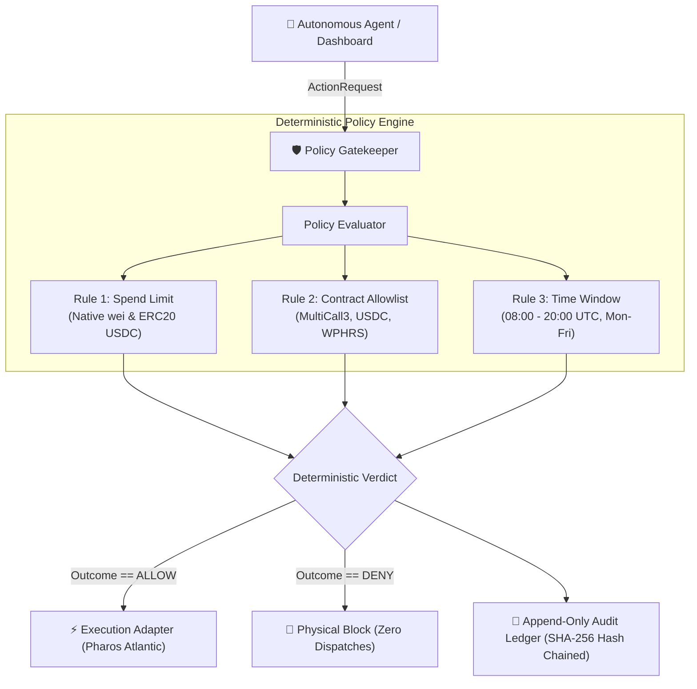

# Pharos Policy Gatekeeper

[](https://atlantic.dplabs-internal.com)
[](https://github.com/JimmyOgb/pharos-policy-gatekeeper)
[](#how-to-test)
[](#automated-testing)
[](LICENSE)
[](#pharos-rpc-compatibility)

A deterministic, fail-closed policy enforcement engine and tamper-evident audit ledger for autonomous agents on the Pharos blockchain (`Chain ID: 688689`). Sits directly between agent decision logic and execution adapters, evaluating proposed transactions against configurable spend limits, contract allowlists, and authorized UTC operating windows.

Built for **Pharos Agent Arena Task 11 — Policy Gatekeeper** (`policy-gatekeeper`).

---

## ⚡ Judge Quickstart: How to Test (30 Seconds)

### Option 1: Live Hosted Dashboard (Vercel)
Open the deployed dashboard in your browser:
**Live Production URL:** [https://pharos-policy-gatekeeper.vercel.app](https://pharos-policy-gatekeeper.vercel.app)

1. **Test Allow (Consensus):** Click the preset **✅ Allow (All Rules Pass)** $\to$ Click **Evaluate Policy Gate**.  
   *Result:* Verdict returns **`ALLOW`**, all 3 rule traces pass, execution status shows `NOT EXECUTED`.
2. **Test Deny (Spend Limit):** Click the preset **🛑 Deny: Spend Limit** (5.0 PHRS) $\to$ Click **Evaluate Policy Gate**.  
   *Result:* Verdict returns **`DENY`** with deciding rule `rule-spend-limit-01` (exceeds 1.0 PHRS cap).
3. **Test Deny (Allowlist):** Click the preset **🛑 Deny: Unlisted Target** (untrusted `0x9999...`) $\to$ Click **Evaluate Policy Gate**.  
   *Result:* Verdict returns **`DENY`** with deciding rule `rule-allowlist-02`.
4. **Test Deny (Time Window):** Click the preset **🛑 Deny: Outside Window** (03:00 UTC) $\to$ Click **Evaluate Policy Gate**.  
   *Result:* Verdict returns **`DENY`** with deciding rule `rule-time-window-03`.
5. **Verify Audit Chain:** Click **🔐 Verify Hash Chain** to cryptographically verify session integrity.

### Option 2: Local CLI Verification
```bash
# Clone the repository
git clone https://github.com/JimmyOgb/pharos-policy-gatekeeper.git
cd pharos-policy-gatekeeper

# Evaluate action proofs via CLI
python cli.py check examples/requests_allow.json --policy examples/policy.yaml
python cli.py check examples/request_deny_spend.json --policy examples/policy.yaml
python cli.py check examples/request_deny_allowlist.json --policy examples/policy.yaml
python cli.py check examples/request_deny_timewindow.json --policy examples/policy.yaml

# Verify SHA-256 hash-chain integrity of local audit ledger
python cli.py audit verify --log audit.jsonl

# Run full test suite (46 Python tests + 16 JavaScript browser evaluator tests)
python -m pytest tests/
node tests/test_browser_evaluator.js
```

---

## Architecture Flow



---

## Dual-Mode Architecture & Safety Disclosures

The web dashboard is engineered with a **dual-mode architecture** to support both local production deployments and hosted demonstrations:

| Operating Mode | Trigger / Condition | Policy Engine | Audit Ledger Persistence | Safety Disclosures |
| :--- | :--- | :--- | :--- | :--- |
| **Mode A: Local Authoritative Mode** | Local FastAPI server reachable (`/api/status`) | Authoritative Python Engine (`policy/evaluator.py`) | Tamper-evident persistent file (`audit.jsonl`) with cryptographic SHA-256 chain | `execution_status: NOT EXECUTED` |
| **Mode B: Hosted Browser-Demo Mode** | Hosted Vercel static environment | Pure deterministic JavaScript engine (`web/evaluator.js`) | Client session memory with simulated SHA-256 chain | `DEMO MODE — BROWSER-SIDE EVALUATION`<br>`execution_status: NOT EXECUTED` |

> [!IMPORTANT]
> **CRITICAL SAFETY NOTICE:**
> Policy decisions are demonstrations only. They do not authorize, execute, block, or secure real wallet transactions.
> Real blockchain transactions are never signed or broadcast from this dashboard, and no real wallets are connected. Every evaluation strictly returns `execution_status: NOT EXECUTED`.
> A `DENY` decision strictly guarantees that zero execution dispatches occur.

---

## Official Acceptance Criteria Alignment

| # | Official Task Requirement | Implementation Approach | Status |
|---|---|---|:---:|
| **01** | Policy file/config with at least 3 rule types (spend limit, allowlist, time window) | Configurable YAML/JSON schema supporting native & ERC20 spend limits, target/selector whitelists, and UTC time windows. | **Implemented & Verified** |
| **02** | Every request returns allow or deny with the specific rule that decided it | Deterministic `Decision` object with explicit `outcome`, `deciding_rule_id`, `deciding_rule_type`, and human-readable `reason`. | **Implemented & Verified** |
| **03** | Denied actions are never executed. Shows at least one deny per rule type | Fail-closed execution gate interceptor. Included test cases and CLI proofs demonstrating denies for spend, allowlist, and time window. | **Implemented & Verified** |
| **04** | Keeps an audit log of all decisions | Append-only structured audit ledger featuring unbroken SHA-256 cryptographic hash chaining (`previous_hash` $\to$ `entry_hash`). | **Implemented & Verified** |

---

## Core Rule Types

### 1. Spend Limit (`spend_limit`)
- Enforces maximum single-transaction native token amount in wei (`max_native_wei` = 1.0 PHRS).
- Enforces maximum cumulative rolling spend over a 24-hour window (`max_cumulative_native_wei` = 5.0 PHRS).
- Decodes and validates standard ERC20 `transfer(address,uint256)` and `approve(address,uint256)` amounts for registered tokens (e.g. test USDC `0xcfC8330f4BCAB529c625D12781b1C19466A9Fc8B`).
- Uses pure integer/BigInt arithmetic to prevent floating-point comparison errors.

### 2. Contract & Address Allowlist (`allowlist`)
- Restricts permissible interaction targets to verified Pharos Atlantic contracts (MultiCall3 `0xcA11bde05977b3631167028862bE2a173976CA11`, Atlantic USDC, Atlantic WPHRS, Operations Safe).
- Enforces case-insensitive address normalization and EIP-55 checksum validation.
- Optionally restricts permitted 4-byte EVM function selectors (`tryAggregate`, `deposit`, `transfer`, `approve`, `withdraw`).

### 3. Execution Time Window (`time_window`)
- Restricts autonomous transactions to authorized operating hours (`08:00:00` to `20:00:00` UTC).
- Enforces authorized days of the week (`MONDAY` through `FRIDAY`).
- Evaluates purely in UTC with clock dependency injection for deterministic testing and reproducible audits.

---

## REST API Reference (Local Mode)

| Method | Endpoint | Description |
|---|---|---|
| `GET` | `/api/status` | Reports backend health, active policy metadata, rule count, audit ledger status, and separate Atlantic network status. |
| `POST` | `/api/check` | Accepts `ActionRequest` payload, evaluates it deterministically, logs to audit ledger, and returns `Decision` object. |
| `GET` | `/api/audit` | Retrieves structured entries from the append-only audit ledger (supports `limit`, `offset`, `tail`). |
| `GET` | `/api/verify` | Runs cryptographic SHA-256 hash-chain verification across all audit records and returns validation status. |

---

## Pharos RPC Compatibility (November 2026)

Pharos announced that debug and trace methods (`debug_traceTransaction`, `debug_traceBlockByNumber`, `debug_traceBlockByHash`, `debug_traceCall`, `trace_filter`) will be disabled on public RPC endpoints before November 2, 2026.

- **Offline-First Core:** The policy engine evaluates rules deterministically without requiring RPC access.
- **Standard JSON-RPC Only:** When optional on-chain block numbers or latency are queried, the engine strictly uses standard methods (`eth_blockNumber`, `eth_chainId`).
- **No Prohibited Methods:** The engine explicitly blacklists debug/trace RPC methods in `policy/config.py`.

---

## Automated Testing

### 1. Python Test Suite (Unit, Security, API)
```bash
python -m pytest tests/ -v
```
**46 passed** (100% pass rate).

### 2. JavaScript Test Suite (Browser Evaluator Engine)
```bash
node tests/test_browser_evaluator.js
```
**16 passed** (100% pass rate).

---

## Demo Video & Media

- **Master 1080p Walkthrough:** [`pharos_policy_gatekeeper_demo.mp4`](pharos_policy_gatekeeper_demo.mp4) (9.44 MB, 1920x1080, 30fps H.264)
- **Narration Audio:** [`voiceover.mp3`](voiceover.mp3) (1.19 MB)

---

## License

MIT License. Copyright 2026 JimmyOgb.
