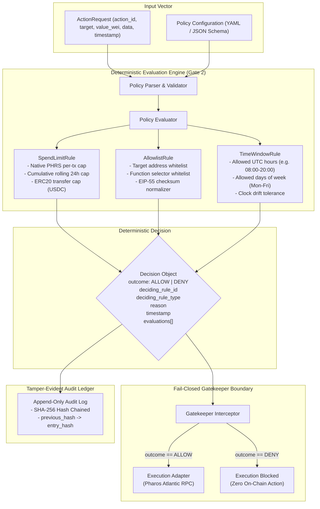

# Pharos Task 11 — Policy Gatekeeper Phased Implementation Plan

**Project:** Policy Gatekeeper  
**Task Slug:** `policy-gatekeeper`  
**Track:** SkillEngine · Medium (100 base + 50 video bonus = 150 points)  
**Workspace:** `C:\Users\NO GO NO\PharosBuild\skills\pharos-policy-gatekeeper`  
**Repository Target:** `JimmyOgb/pharos-policy-gatekeeper`  

---

## 1. System Architecture & Component Flow

The Policy Gatekeeper serves as a deterministic security firewall interposed between agent decision engines (or user interfaces) and on-chain execution adapters.

---

## 2. Rule Type Specifications & Evaluation Logic

### A. Spend Limit Rule (`spend_limit`)
- **Native Token (`PHRS`):**
  - Compares `request.value_wei` against configured `max_native_wei`.
  - Maintains rolling 24-hour cumulative spend cache; rejects requests where $(\text{cumulative} + \text{value}) > \text{max\_cumulative\_native\_wei}$.
- **ERC20 Token Transfers (`USDC`, `WPHRS`):**
  - Parses 4-byte selector:
    - `0xa9059cbb`: `transfer(address,uint256)`
    - `0x095ea7b3`: `approve(address,uint256)`
  - Extracts raw amount from the calldata words and multiplies against token decimals.
  - Compares against `token.max_amount_raw`.
- **Verdict:** If any amount exceeds thresholds, returns `DENY` with deciding rule ID `rule-spend-limit-XX` and precise numeric breakdown.

### B. Target & Selector Allowlist Rule (`allowlist`)
- **Address Whitelisting:**
  - Converts input address and allowlist entries to standard lowercase or EIP-55 checksum format to eliminate casing discrepancies.
  - If `request.target` is not in `allowed_addresses`, returns `DENY` with reason: `Target address {target} is not in authorized allowlist`.
- **Selector Filtering:**
  - If `allowed_function_selectors` is non-empty, extracts first 4 bytes of `request.data`.
  - If selector is not explicitly allowed, returns `DENY` with selector attribution.
- **Fail-Closed Default:** Unlisted contracts are rejected unconditionally (`allow_unknown_targets: false`).

### C. Execution Time Window Rule (`time_window`)
- **UTC Time of Day:**
  - Configurable start (`allowed_start_utc`, e.g. `"08:00:00"`) and end (`allowed_end_utc`, e.g. `"20:00:00"`).
  - Evaluates request timestamp modulo 86,400 seconds.
- **Allowed Days of Week:**
  - Array of allowed days: `["MONDAY", "TUESDAY", "WEDNESDAY", "THURSDAY", "FRIDAY"]`.
  - Rejects weekend executions if not explicitly permitted.
- **Timestamp Integrity:**
  - Evaluates timestamp supplied in `ActionRequest`. In live mode, cross-checks against current Atlantic block timestamp via `eth_getBlockByNumber` to prevent agent timestamp spoofing.

---

## 3. Fail-Closed Enforcement Invariants

1. **Missing Policy:** If no policy file is loaded or the policy file cannot be read, gatekeeper returns `DENY` (`deciding_rule_type: fail_closed_default`).
2. **Schema Validation Errors:** If policy YAML/JSON fails schema validation, gatekeeper returns `DENY`.
3. **Unknown Action Type:** If action type is anything other than recognized EVM actions (`evm_call`, `evm_transfer`), gatekeeper returns `DENY`.
4. **Unhandled Exceptions:** If any evaluator logic throws an unexpected runtime error, an outer catch block converts the outcome to `DENY` with reason `Internal evaluation failure (fail-closed default)`.
5. **Physical Interception:** The `Gatekeeper.execute_safely()` method requires `decision.outcome == Outcome.ALLOW` as a strict prerequisite before invoking any downstream execution callback.

---

## 4. Tamper-Evident Audit Ledger Design

### SHA-256 Cryptographic Hash Chaining
Every decision is appended to `audit.jsonl` with continuous hash chaining:
$$\text{payload} = \text{canonical\_json}(\{ \text{sequence\_number}, \text{decision\_id}, \text{timestamp}, \text{policy\_id}, \text{action\_request}, \text{outcome}, \text{deciding\_rule\_id}, \text{reason} \})$$
$$\text{entry\_hash} = \text{SHA-256}(\text{previous\_hash} \,||\, \text{payload})$$

- **Genesis Record (Sequence 0):** Uses $\text{previous\_hash} = 0^{64}$ (64 zeros).
- **Subsequent Records (Sequence $N$):** Uses $\text{previous\_hash} = \text{entry\_hash}_{N-1}$.
- **Verification Routine:** `AuditLogger.verify_integrity()` reads every log entry sequentially, recalculates every SHA-256 hash, and verifies that no record has been inserted, removed, reordered, or modified.

---

## 5. Phased Verification Gates

| Gate | Phase Description | Verification Invariant |
|:---:|---|---|
| **Gate 1** | **Requirements, Architecture & Scaffolding** | Requirements verified, zero trace method dependence, clean isolated workspace initialized. |
| **Gate 2** | **Deterministic Policy Engine Implementation** | Pure Python engine, 100% deterministic, 3 rule types, fail-closed enforcement, SHA-256 audit logger, comprehensive unit tests passing. |
| **Gate 3** | **Product & Dashboard Integration** | FastAPI backend, responsive dark-mode Web UI, real-time Atlantic RPC status, live check simulator, audit log viewer. |
| **Gate 4** | **Technical Acceptance Audit** | Line-by-line verification against official Task 11 criteria, zero regressions, all 3 deny proofs validated. |
| **Gate 5** | **Live Atlantic Read-Only Preflight & RPC Verification** | Live query against Atlantic Testnet (`Chain ID: 688689`), MultiCall3, USDC, standard JSON-RPC only. |
| **Gate 6** | **Live Demo Video Recording** | 1080p recorded demo with animated cursor, edge-tts narration, showing all 3 deny proofs, audit log verification, and dashboard. |
| **Gate 7** | **Repository Packaging & Documentation** | Production README, SKILL.md, clean .gitignore, license, and test documentation. |
| **Gate 8** | **Deployment & Submission** | GitHub publication, Vercel production deployment, and Agent Arena submission. |

---

## 6. Dependencies & $0-First Assessment

- **Python Core:** Standard library (`json`, `hashlib`, `datetime`, `dataclasses`, `enum`, `abc`, `re`, `argparse`). Zero paid packages required.
- **Web & Backend (Gate 3):** Lightweight `fastapi` and `uvicorn` for REST API; static HTML5/CSS3/vanilla JS for dashboard (zero npm build step, 100% Vercel static compatible).
- **Network Fees:** $0.00. Evaluator operates offline-first; live queries utilize free public Pharos Atlantic RPC (`https://atlantic.dplabs-internal.com`).
